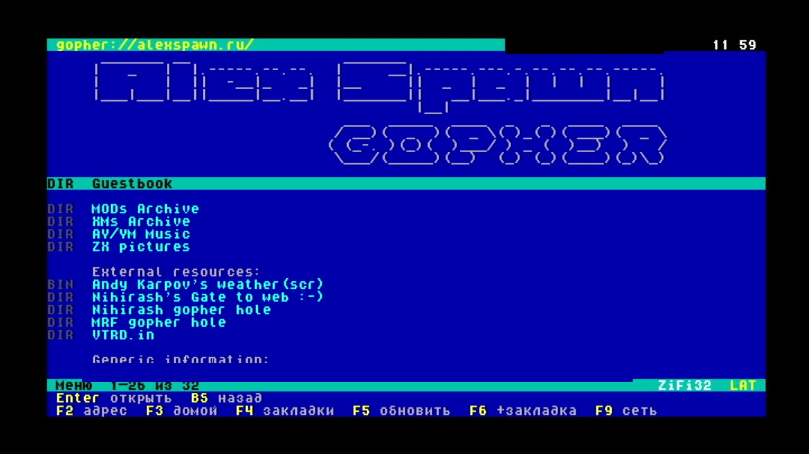

# karabas gopher

[Русская версия](README.ru.md)

A Gopher browser for TS-Conf (ZX Spectrum), an `.spg` program started from Wild Commander. Made for
the TS-Conf core of the Karabas Go, Mini and Mini G boards, with three ways to the network, a
background music player and a picture viewer.



Status: version 1.0 ([CHANGELOG](CHANGELOG.md)), works on the Karabas Mini G (all features below
checked there). Other TS-Conf machines (ZX-Evolution) are not tested.

## Download

`karabas_gopher.spg` of each version is on the [Releases](https://github.com/andykarpov/karabas-gopher/releases)
page; the current one is also in the Karabas release repo:
[karabas-go/software](https://github.com/andykarpov/karabas-go/tree/master/software).

## Features

- **Network backends**, found at start, chosen automatically or in the settings:
  - ZiFi32: the ESP32-S3 module of tslabs on the SPI of the Z-controller (firmware 0.6.4 or newer
    for tracker music);
  - ZiFi: an ESP8266 with the standard AT firmware on the UART of the core (set up by the boot core);
  - USB serial: the RS232 of the core through the board MCU (USB CDC) to a PC running
    `tools/at_proxy.py`, or to a real ESP8266 on a USB-UART adapter.
- **Wi-Fi**: network scan, join (hidden networks too), forget, status; the network of ZiFi32 is kept
  in `/zifi/gopher.ini`. An existing `/zifi/ZIFI.INI` of the old ZiFi client is offered as a start.
- **Browsing**: menus, text pages (wrapped at 80 columns), search (type 7), history, bookmarks
  (`/zifi/bookmarks.txt`), any address (F2), home page; UTF-8 / CP1251 / KOI8-R / CP866 pages.
- **Screen**: 80 x 30 text in the font of Wild Commander; the header shows the Wi-Fi network,
  signal, lock and the time of the board clock; a status row, a row of hints, a message row.
- **Downloads**: F10 on any file, into `/downloads/YYYY_MM_DD/`; a taken name gets `_1`.. `_99`;
  Esc cancels and deletes the unfinished file.
- **Music in the background** (it plays on while you browse): Enter on a module plays all the music
  of that menu one after another.
  - PT3 (and TurboSound PT3) on the AY chips, player of S.V.Bulba; PT2 (his universal player);
    STC (Sound Tracker) and ASC (ASC Sound Master) with our own players;
  - MOD on the General Sound of the core (default) or on ZiFi32;
  - XM and S3M on ZiFi32 (firmware 0.6.4+); without it they can only be downloaded.
  - F7 pause, Shift+F7 stop, F8 / Shift+F8 next / previous, from any screen; the cursor of the
    menu follows the track that plays.
- **Pictures**: `.scr` (6912 / 6144), multicolour `.mc` / `.mlt`, gigascreen `.img` (shown without
  flicker), `.bmp` 4 / 8 bits up to 360 x 288. Arrows: the neighbours of the menu, **S**: slide show
  (5 s a picture, the next one loads meanwhile).

## Getting started

1. Copy `karabas_gopher.spg` to the SD card (or build it, below).
2. In Wild Commander select it and press Enter.
3. F9 opens the network screen: the modules found, the connection, Wi-Fi, settings (home page,
   charset, downloads folder). F2 there saves `/zifi/gopher.ini`.

| Key | Action |
|---|---|
| Arrows, PgUp / PgDn, Home / End | move |
| Enter / Right | open, play, view |
| BS / Left | back |
| F2 | address |
| F3 | home page |
| F4 / F6 / Del | bookmarks / add one / delete one |
| F5 | reload |
| F9 | network |
| F10 | download (in a text page: save it) |
| F7, Shift+F7, F8, Shift+F8 | pause, stop, next, previous track |
| Ins | Russian / Latin keyboard |

## Settings file

`/zifi/gopher.ini` (made by F2 in the network or settings screen; comments and unknown lines are kept):

```ini
; a comment is a line of its own (";" or "#"): the rest of a line is the value
[net]
; auto, zifi32, zifi, usb
backend=auto
[zifi32]
; the network of ZiFi32 (the ESP8266 keeps its own, set by the boot core)
ssid=MyNet
password=...
autoconnect=1
[gopher]
home=gopher://alexspawn.ru/
; utf8, cp1251, koi8, cp866
charset=utf8
downloads=/downloads
```

## USB serial

The browser speaks AT over the RS232 of the TS-Conf core, which the board MCU passes to the PC as a
USB serial port. On the PC run

```
python3 tools/at_proxy.py --tty /dev/serial/by-id/usb-Karabas_Go_...-if02
```

(the clean port of the board: CDC `if02`, or a USB-UART adapter). The proxy answers like an
ESP8266 with the AT firmware and makes the TCP connections itself; it never accepts AT+RST,
AT+RESTORE, AT+UART_DEF= or AT+SYSSTORE. A real ESP8266 on a USB-UART adapter works the same way.

## Building

Needs SDCC 4.2 (`sdcc`, `sdasz80`), sjasmplus (for the PT3 player), Python 3 with Pillow (tests),
`iconv`, gcc and `mkfs.fat` (host tests).

```
make          # build/gopher.spg
make test     # host tests (seconds): keyboard, editor, INI, gopher parsing, AT driver against
              # tools/at_proxy.py, downloads on FatFs (+ fsck.fat), the picture decoders, the STC /
              # ASC players frame by frame against reference dumps
make emu      # a headless run in the unreal-ng emulator (emu-shot), screenshot build/emu.png
make aytest P=stc M=tests/data/ay/stc1.stc   # an STC / ASC player built for the Z80, in the emulator
```

The version is in `VERSION`. A tag `v<version>` makes the CI build, test and publish a release with
`karabas_gopher.spg` and the notes of that version from `CHANGELOG.md`.

The design, the memory map and the phases are in [docs/PLAN.md](docs/PLAN.md) (in Russian), the
state of the work in [docs/BACKLOG.md](docs/BACKLOG.md).

## Third-party code

- FatFs R0.15 by ChaN (`src/fatfs`): its own BSD-style licence in the files.
- The PT3 player of S.V.Bulba (Vortex Tracker II, release 7), from the tslabs zx-evo SDK
  (`src/player/pt3play.asm`), freeware with the author's notice kept; his universal PT2 / PT3 player
  (`src/player/ptsplay.asm`, from NedoOS, originally in Vortex Tracker II).
- The reference register dumps `tests/data/ay/*.regs` were made with AYFly (GPL, not in this
  repository); the STC / ASC players and the test modules are our own.
- The 8x8 font of Wild Commander (`res/font866.bin`, tslabs zx-evo).
- `src/net/esp_at_parse.*` from karabas-go-firmware (MIT).

Everything else: MIT, see [LICENSE](LICENSE).
