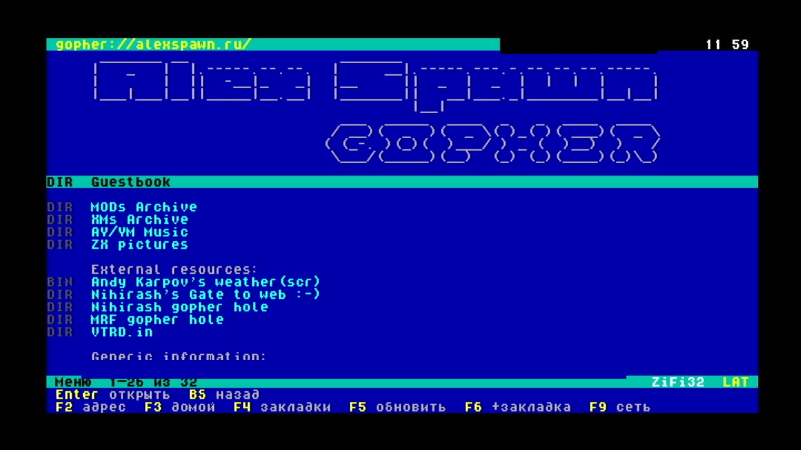

# karabas gopher

[English version](README.md)

Gopher-браузер для TS-Conf (ZX Spectrum): программа `.spg`, запускается из Wild Commander. Сделан
для ядра TS-Conf плат Karabas Go, Mini и Mini G: три способа выйти в сеть, фоновый музыкальный
плеер и просмотр картинок.



Состояние: работает на Karabas Mini G (всё, что ниже, проверено на ней). Другие машины с TS-Conf
(ZX-Evolution) не проверялись.

## Возможности

- **Сеть**, модули ищутся при старте, подключение выбирается само или в настройках:
  - ZiFi32 — модуль ESP32-S3 от tslabs на SPI Z-контроллера (для трекерной музыки — прошивка 0.6.4
    и новее);
  - ZiFi — ESP8266 со стандартной AT-прошивкой на UART ядра (настраивается boot-ядром);
  - USB serial — RS232 ядра через MCU платы (USB CDC) на ПК со скриптом `tools/at_proxy.py` или на
    настоящий ESP8266 через USB-UART.
- **Wi-Fi**: поиск сетей, подключение (и к скрытой), «забыть», состояние; сеть ZiFi32 хранится в
  `/zifi/gopher.ini`. Если есть `/zifi/ZIFI.INI` старого клиента, браузер предложит взять сеть оттуда.
- **Просмотр**: меню, текст (перенос по 80 колонкам), поиск (тип 7), история, закладки
  (`/zifi/bookmarks.txt`), любой адрес (F2), домашняя страница; страницы в UTF-8 / CP1251 / KOI8-R /
  CP866.
- **Экран**: текст 80 x 30 шрифтом Wild Commander; в шапке — сеть Wi-Fi, сигнал, замок и время с
  часов платы; строка состояния, строка подсказок, строка сообщений.
- **Скачивание**: F10 на любом файле, в `/downloads/ГГГГ_ММ_ДД/`; занятое имя получает `_1`.. `_99`;
  Esc прерывает и удаляет недокачанный файл.
- **Музыка в фоне** (играет, пока ходишь по страницам): Enter на модуле играет всю музыку этого меню
  подряд.
  - PT3 (и TurboSound PT3) на AY, плеер S.V.Bulba;
  - MOD на General Sound ядра (по умолчанию) или на ZiFi32;
  - XM и S3M на ZiFi32 (прошивка 0.6.4+), без него — только скачать;
  - F7 пауза, Shift+F7 стоп, F8 / Shift+F8 следующий / предыдущий — из любого экрана.
- **Картинки**: `.scr` (6912 / 6144), мультиколор `.mc` / `.mlt`, гигаскрин `.img` (без мерцания),
  `.bmp` 4 / 8 бит до 360 x 288. Стрелки — соседние картинки меню, **S** — слайдшоу (5 с на
  картинку, следующая грузится, пока видна текущая).

## Начало работы

1. Соберите `build/gopher.spg` (ниже) и положите его на SD-карту.
2. В Wild Commander выберите `gopher.spg` и нажмите Enter.
3. F9 — экран «Сеть»: найденные модули, подключение, Wi-Fi, настройки (домашняя страница,
   кодировка, папка загрузок). F2 там сохраняет `/zifi/gopher.ini`.

| Клавиша | Действие |
|---|---|
| Стрелки, PgUp / PgDn, Home / End | перемещение |
| Enter / → | открыть, играть, смотреть |
| BS / ← | назад |
| F2 | адрес |
| F3 | домой |
| F4 / F6 / Del | закладки / добавить / удалить |
| F5 | обновить |
| F9 | сеть |
| F10 | скачать (в тексте — сохранить его) |
| F7, Shift+F7, F8, Shift+F8 | пауза, стоп, следующий, предыдущий трек |
| Ins | русская / латинская раскладка |

## Сборка

Нужны SDCC 4.2 (`sdcc`, `sdasz80`), sjasmplus (плеер PT3), Python 3 с Pillow (тесты), `iconv`, gcc и
`mkfs.fat` (тесты на ПК).

```
make          # build/gopher.spg
make test     # тесты на ПК (секунды): клавиатура, редактор, INI, разбор gopher, AT-драйвер против
              # tools/at_proxy.py, скачивание на FatFs (+ fsck.fat), декодеры картинок
make emu      # запуск в эмуляторе unreal-ng без окна (emu-shot), снимок build/emu.png
```

Устройство, карта памяти и фазы — в [docs/PLAN.md](docs/PLAN.md), состояние работ — в
[docs/BACKLOG.md](docs/BACKLOG.md).

## Чужой код

- FatFs R0.15, ChaN (`src/fatfs`): своя лицензия в стиле BSD в файлах.
- Плеер PT3 S.V.Bulba (Vortex Tracker II, release 7) из SDK tslabs zx-evo
  (`src/player/pt3play.asm`), freeware, с сохранённым уведомлением автора.
- Шрифт 8x8 Wild Commander (`res/font866.bin`, tslabs zx-evo).
- `src/net/esp_at_parse.*` из karabas-go-firmware (MIT).

Остальное — MIT, см. [LICENSE](LICENSE).
